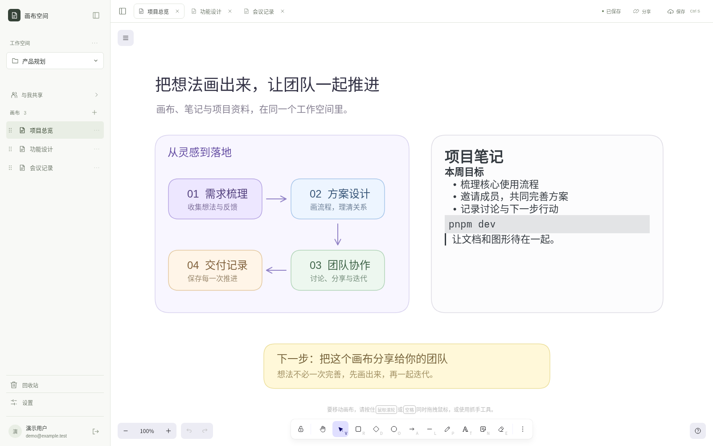

<h1>Excalidraw Workspace</h1>

  
  
  
  

Excalidraw Workspace 是一个可以管理多个画布的在线应用，支持自动保存、云同步、画布内编辑markdown、多人协作、画布分享，支持 Cloudflare Worker 和 docker 部署，本项目基于 nuxt 和 excalidraw。

  <a href="https://excalidraw-workspace.qiudeng.workers.dev/"><strong>在线使用</strong></a> ·
  <a href="docs/deployment.md#docker">Docker 部署</a> ·
  <a href="docs/deployment.md#cloudflare-workers">Cloudflare 部署</a> ·
  <a href="#目录">开发文档</a> ·
  <a href="https://github.com/qiudeng7/excalidraw-workspace/releases">更新日志</a>

## 目录

[本地启动](docs/development/local-development.md) · [开发规范](docs/development/workflow.md) · [架构](docs/development/architecture.md) · [验证](docs/development/testing.md) · [部署](docs/deployment.md) · [许可证](docs/license.md)

| 功能模块                                        | 用例                                                                                                                                                                                                                                                                                                                                                                                                                                               |
| ----------------------------------------------- | -------------------------------------------------------------------------------------------------------------------------------------------------------------------------------------------------------------------------------------------------------------------------------------------------------------------------------------------------------------------------------------------------------------------------------------------------- |
| [账户与访问](docs/development/accounts.md)      | [初始化管理员](docs/development/accounts.md#初始化管理员)、[注册与登录](docs/development/accounts.md#注册与登录)、[恢复登录状态](docs/development/accounts.md#恢复登录状态)、[退出登录](docs/development/accounts.md#退出登录)、[修改密码](docs/development/accounts.md#修改密码)、[管理注册权限](docs/development/accounts.md#管理注册权限)                                                                                                       |
| [工作空间](docs/development/workspaces.md)      | [恢复工作目录](docs/development/workspaces.md#恢复工作目录)、[切换工作空间](docs/development/workspaces.md#切换工作空间)、[创建工作空间](docs/development/workspaces.md#创建工作空间)、[重命名工作空间](docs/development/workspaces.md#重命名工作空间)、[删除工作空间](docs/development/workspaces.md#删除工作空间)                                                                                                                                |
| [画布](docs/development/canvases.md)            | [创建画布](docs/development/canvases.md#创建画布)、[切换画布](docs/development/canvases.md#切换画布)、[打开多个画布](docs/development/canvases.md#打开多个画布)、[保存内容](docs/development/canvases.md#保存内容)、[处理保存冲突](docs/development/canvases.md#处理保存冲突)、[重命名画布](docs/development/canvases.md#重命名画布)、[删除画布](docs/development/canvases.md#删除画布)、[调整画布顺序](docs/development/canvases.md#调整画布顺序) |
| [个人素材库](docs/development/library.md)       | [读取素材库](docs/development/library.md#读取素材库)、[保存素材库](docs/development/library.md#保存素材库)                                                                                                                                                                                                                                                                                                                                         |
| [账户设置](docs/development/user-settings.md)   | [加载设置](docs/development/user-settings.md#加载设置)、[修改与保存设置](docs/development/user-settings.md#修改与保存设置)、[处理设置冲突](docs/development/user-settings.md#处理设置冲突)                                                                                                                                                                                                                                                         |
| [编辑器](docs/development/editor.md)            | [调整绘图交互](docs/development/editor.md#调整绘图交互)、[编辑富文本](docs/development/editor.md#编辑富文本)、[收藏与复用颜色](docs/development/editor.md#收藏与复用颜色)、[导入导出与复制](docs/development/editor.md#导入导出与复制)                                                                                                                                                                                                             |
| [更新公告与日志](docs/development/releases.md)  | [自动展示公告](docs/development/releases.md#自动展示公告)、[回看历史更新](docs/development/releases.md#回看历史更新)、[维护发布内容](docs/development/releases.md#发布新公告)                                                                                                                                                                                                                                                                      |
| [协作与分享](docs/development/collaboration.md) | [并发编辑](docs/development/collaboration.md#并发编辑)、[成员邀请与链接](docs/development/collaboration.md#成员邀请与链接)、[三种查看模式](docs/development/collaboration.md#三种查看模式)、[离线队列](docs/development/collaboration.md#离线队列)、[权限撤销](docs/development/collaboration.md#权限撤销)、[房间迁移和恢复](docs/development/collaboration.md#迁移删除图片与备份)                                                                 |

## License

本项目自己的代码采用 [MIT](LICENSE) 许可证，纳入仓库的 Excalidraw 代码保留[上游 MIT 版权与许可声明](packages/excalidraw/LICENSE)。发布产物随附这两份许可原文，可在“设置 → 通用 → 开源许可”查看；详情见[许可证文档](docs/license.md)。
