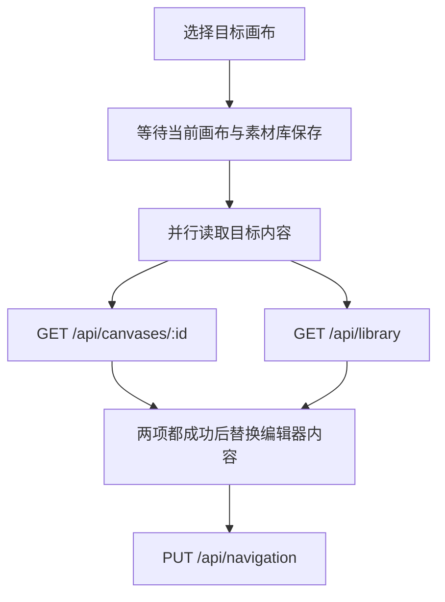

# 画布

[返回开发者指南](readme.md)

画布的目录操作与内容保存分开处理：名称、顺序和归属在数据库中，图形、应用状态和图片组成场景快照。目录用例在 [useWorkspaceDirectory.ts](../../src/composables/useWorkspaceDirectory.ts)，内容读取在 [useCanvasDocument.ts](../../src/composables/useCanvasDocument.ts)，编辑和保存接入在 [ExcalidrawCanvas.client.vue](../../src/components/ExcalidrawCanvas.client.vue)。

## 创建画布

`createCanvas()` 等待当前编辑器保存，再通过 [POST /api/workspaces/:id/canvases](../../server/api/workspaces/[id]/canvases.post.ts) 提交名称和目录版本 `catalogRevision`。后端验证空间归属，通过 [db/canvases.ts](../../server/db/canvases.ts) 原子插入画布到目录顶部，并递增目录版本。

成功后前端重新读取 [GET /api/workspaces/:id/canvases](../../server/api/workspaces/[id]/canvases.get.ts)，再读取新画布和素材库、记录最近位置，后两步见[切换画布](#切换画布)。新画布尚无快照，读取时返回空场景。

创建失败时也重新确认目录，然后报告原错误。目录无法确认时锁定目录修改，避免继续使用旧版本操作。

## 切换画布

用户选择另一张画布时，`selectCanvas()` 先等待保存，再读取目标内容，最后记录最近位置。

- [GET /api/canvases/:id](../../server/api/canvases/[id].get.ts)：校验归属后读取场景。若快照刚被并发保存替换、旧对象已删除，重新读取数据库引用后再尝试一次。
- [GET /api/library](../../server/api/library.get.ts)：读取当前账户的[个人素材库](library.md#读取素材库)。两项读取由 `useCanvasDocument.loadCanvas()` 并行发起，全部成功才替换文档。
- [PUT /api/navigation](../../server/api/navigation.put.ts)：提交 `{ canvasId, revision }`，更新全局及空间内的最近位置。`useWorkspaceNavigation.recordOpened()` 必要时先通过 [GET /api/navigation](../../server/api/navigation.get.ts) 取得版本。

保存或内容读取失败会中止切换。导航写入失败不会撤销已经打开的画布；发生 `NAVIGATION_CONFLICT` 时只提示并读取最新导航，不重试覆盖，也不改变当前选择。导航控制器见 [useWorkspaceNavigation.ts](../../src/composables/useWorkspaceNavigation.ts)。

## 保存内容

编辑器的 `onChange` 将场景交给 [PersistentResource](../../src/lib/persistence.ts)，暂存本地草稿并安排自动保存；`Ctrl+S` / `Cmd+S` 调用包装组件的 `saveManually()`，立即保存画布并等待素材库保存。显式保存即使没有新修改，也提交画布快照并显示反馈。

[PUT /api/canvases/:id](../../server/api/canvases/[id].put.ts) 接收 `{ revision, scene }`，其中 `scene` 包含 `elements`、`appState`、`files`。处理器校验归属和场景形状，再调用 [saveSnapshot()](../../server/utils/snapshots.ts)：校验版本 → 写入新快照 → 按预期版本更新数据库引用 → 后台删除旧快照。成功返回新的版本与更新时间。原子性边界见[版本与快照](architecture.md#版本与快照)。

单次 JSON 请求上限为 20 MB。保存失败时显示错误并尽可能保留本地草稿；切换画布、切换空间、退出登录和站内离开前须等待保存。刷新或关闭页面使用 `beforeunload` 提醒，关闭页面不会保证完成保存。

## 处理保存冲突

其他页面已保存同一画布，导致版本不符时，保存接口返回 `409 REVISION_CONFLICT`。[PersistentResource](../../src/lib/persistence.ts) 停止继续覆盖，包装组件提供下载本地备份，以及确认舍弃冲突草稿后加载云端内容的操作。

画布在请求前已被删除时，归属查询返回 `404 NOT_FOUND`，页面按保存失败保留草稿；若删除发生在归属查询之后、版本写入之前，则写入失败返回 `409 REVISION_CONFLICT`。

“加载云端”先清理发生冲突的资源草稿，再刷新页面；未冲突资源的待保存草稿保留。此操作沿页面初始化流程重新读取内容。画布冲突没有“自动合并后覆盖”的步骤，账户设置的冲突选择见[处理设置冲突](user-settings.md#处理设置冲突)。

## 重命名画布

`renameCanvas()` 等待保存，通过 [PATCH /api/canvases/:id](../../server/api/canvases/[id].patch.ts) 提交名称。后端更新元数据并返回画布信息；前端同时更新目录条目和当前文档名称。此操作不提交场景快照。

## 删除画布

`deleteCanvas()` 确认后等待保存，通过 [DELETE /api/canvases/:id](../../server/api/canvases/[id].delete.ts) 携带 `{ catalogRevision }`。后端校验归属和目录版本，删除画布、递增目录版本，并后台删除快照。

前端无论请求是否报错都会重新读取目录，确认画布是否仍存在；这也处理“服务端已删除但响应丢失”的情况。若删除的是当前画布，清空文档、刷新导航，再打开剩余目录中的第一张；目录为空则保留空状态。

## 调整画布顺序

拖拽及键盘动作由 [useCanvasReorder.ts](../../src/composables/useCanvasReorder.ts) 转成完整 ID 顺序，交给 `useWorkspaceDirectory.reorderCanvas()`。前端先预览顺序，再通过 [PUT /api/workspaces/:id/canvas-order](../../server/api/workspaces/[id]/canvas-order.put.ts) 提交 `{ canvasIds, catalogRevision }`。

后端要求列表包含空间内全部画布、没有重复或遗漏，通过 [reorderCanvases()](../../server/db/canvases.ts) 原子更新顺序和目录版本。版本不符返回 `409 CATALOG_CONFLICT`。

请求失败后，前端先恢复原列表，再通过 [GET /api/workspaces/:id/canvases](../../server/api/workspaces/[id]/canvases.get.ts) 确认服务端结果，不自动重试旧顺序。目录仍无法读取时锁定目录修改，用户重新加载成功后再开放操作。

## 验证入口

[navigation.test.ts](../../tests/integration/navigation.test.ts) 覆盖目录版本、排序和导航；[node-storage.test.ts](../../tests/integration/node-storage.test.ts) 检查含图片快照读写、并发与重启持久化；[snapshots.test.ts](../../tests/unit/snapshots.test.ts) 检查发布失败的新对象回收；[persistence-owner.test.ts](../../tests/unit/persistence-owner.test.ts) 检查保存资源的账户归属与请求取消；[frontend-controllers.test.ts](../../tests/unit/frontend-controllers.test.ts) 检查读取和切换保护。浏览器中检查含图片保存、快捷键反馈、双标签页冲突、失败时切换保护，以及拖拽和键盘排序。
