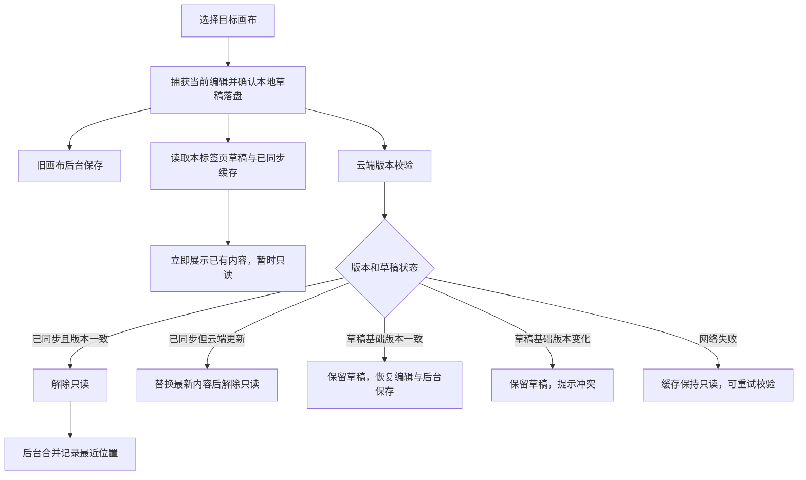

# 画布

[返回目录](../../README.md#目录)

单人打开画布时继续使用快照保存；第二个编辑会话打开，或使用分享功能时才迁入协作协议。并发编辑、三种查看模式、离线队列及权限流程见[协作与分享](collaboration.md)。目录和排序流程不依赖保存协议。

画布的目录操作与内容保存分开处理：名称、顺序和归属在数据库中，图形、应用状态和图片组成场景快照。目录用例在 [useWorkspaceDirectory.ts](../../src/composables/useWorkspaceDirectory.ts)，内容读取在 [useCanvasDocument.ts](../../src/composables/useCanvasDocument.ts)，账号级缓存和后台资源在 [canvasResources.ts](../../src/lib/canvasResources.ts)，编辑器接入在 [ExcalidrawCanvas.client.vue](../../src/components/ExcalidrawCanvas.client.vue)。

## 创建画布

`createCanvas()` 等待当前编辑器保存，再通过 [POST /api/workspaces/:id/canvases](../../server/api/workspaces/[id]/canvases.post.ts) 提交名称和目录版本 `catalogRevision`。后端验证空间归属，通过 [db/canvases.ts](../../server/db/canvases.ts) 原子插入画布到基础顺序顶部，并递增目录版本；新画布未置顶，显示在未置顶组顶部。

成功后前端重新读取 [GET /api/workspaces/:id/canvases](../../server/api/workspaces/[id]/canvases.get.ts)，再读取新画布、后台记录最近位置，后两步见[切换画布](#切换画布)。新画布尚无快照，读取时返回空场景。

创建失败时也重新确认目录，然后报告原错误。目录无法确认时锁定目录修改，避免继续使用旧版本操作。

## 切换画布

用户选择另一张画布时，`selectCanvas()` 捕获当前场景并等待最新草稿写入 IndexedDB，然后立即启动目标加载。旧画布的云端保存由账号级资源继续执行，不随 React 编辑器卸载取消；不同资源最多同时进行两次保存，同一资源仍只有一个保存请求。

素材库不参与这条加载链路，见[素材库按需读取](library.md#读取素材库)。没有本地内容时等待云端返回；有本地内容时允许平移、缩放和查看，禁止绘制、粘贴、拖放、导入、撤销、删除和素材插入。临时只读与用户自己开启的查看模式分别管理，初始化和只读视角变化不会触发保存。

[GET /api/canvases/:id](../../server/api/canvases/[id].get.ts) 先鉴权、检查 owner 和数据库归属。内存命中时携带 `If-None-Match`；服务器比较内容版本及目录元数据，完全相同返回无响应体的 `304`，不读取对象存储；版本变化返回完整内容。首次磁盘读取与网络请求并行，所以磁盘命中的第一次打开仍可能接收完整响应。所有响应保留 `Cache-Control: no-store`，缓存由应用主动管理。对象刚被并发保存替换时，重新读取数据库引用后再尝试一次。

切换和初始化目录期间，目录的新增、删除、重命名和排序暂不可用；画布与工作空间仍可继续切换，最后一次选择生效。删除成功会使对应的内存资源和已同步缓存失效，迟到的读取不能重新显示它。

快速切回仍在保存的画布，展示最新本地内容并保持只读，等自己的保存完成后再校验，避免把自己的新版本误判为外部修改。保存响应丢失时先回读版本和上传快照，确认已被接受后才确认保存；无法确定时保留草稿和冲突提示，不把草稿自动套用到新版本上。

快速点击多个画布时，最后一次选择决定当前编辑器；同一画布的读取合并，较晚返回的旧选择只更新对应缓存。[最近位置](../../src/composables/useWorkspaceNavigation.ts) 在后台按顺序写入，并合并等待中的选择；导航冲突只提示和读取最新版本，不移动当前画布。

### 缓存与草稿边界

[confirmedCache.ts](../../src/lib/confirmedCache.ts) 管理已同步快照；[persistence.ts](../../src/lib/persistence.ts) 管理未同步草稿。两者使用不同 IndexedDB 数据库，草稿不参与缓存淘汰。

| 内容             | 键与保留规则                                                                                                                 |
| ---------------- | ---------------------------------------------------------------------------------------------------------------------------- |
| 活跃或未同步资源 | 当前账号与画布，草稿另带独占标签页 ID；当前、dirty、保存中和校验中的资源固定保留                                             |
| 已同步内存资源   | 当前画布加最近四张未固定画布；估算序列化容量上限 64 MiB，当前画布及未同步资源不计入可淘汰项                                  |
| 已同步磁盘快照   | `schemaVersion + accountId + type + resourceId`，包含 revision、内容、字节数和最近访问时间；画布图片和素材库合计最多 256 MiB |

容量限制按序列化体积估算，并非浏览器实际堆内存上限。超大单项不强制放进可淘汰缓存；缓存不可用时回退云端，草稿写入失败且云端尚未保存成功时保留当前画布，不能无保护切走。

缓存只接收成功 GET 或 PUT 确认的不可变快照。保存期间产生的新编辑继续保持 dirty，旧响应不能确认新编辑，也不能用较旧 revision 回退缓存。账号切换清空内存、取消旧读取；权限失效或画布被删除后移除已同步缓存并停止显示该画布，未同步草稿仍独立保留。

## 打开多个画布

点击侧边栏文件会打开或激活一个标签，标签名随文件重命名更新。同一文件不会重复打开；标签只切换当前可见画布，页面始终挂载一个编辑器。顶栏不再显示工作空间面包屑，工作空间仍在侧边栏切换。

[useCanvasTabs.ts](../../src/composables/useCanvasTabs.ts) 按工作空间在内存保存标签顺序和当前标签。切换工作空间再返回会恢复原标签；退出账号或刷新页面后重新按最近位置打开画布，不跨账号复用标签。左右方向键、Home、End 可在标签间切换；Delete 或关闭按钮关闭标签。这些按键不会继续触发画布的移动、删除快捷键。

关闭当前标签先确认本地草稿落盘，再激活右侧相邻标签，没有右侧则激活左侧。关闭最后一个标签保留文件列表，显示打开侧边栏和新建画布入口；再次切换回这个工作空间也不会自动重开文件。关闭标签不会删除文件、释放未同步资源或取消后台保存。退出登录与站内离开继续等待全部画布保存；页面关闭提醒同时检查快照资源和已关闭标签的协作操作队列。只有当前显示的画布登记打开会话，后台标签不登记。

每个画布的视角和工具保存在 `CanvasResource.editorContext`，不写入共享内容。返回标签时，若画布内容签名和协作 epoch 未变，则恢复该画布的内容撤销/重做记录；保存确认只改变 revision 时仍可恢复。后台期间远端内容或 epoch 变化则清空旧历史，避免旧撤销覆盖他人修改。内容签名使用元素 ID、版本、nonce、删除状态、顺序和共享背景，忽略快照恢复时补齐的默认字段。

[editorHistory.ts](../../src/lib/editorHistory.ts) 在内存保留历史 delta 对象及撤销所需图片文件；编辑器 [History](../../packages/excalidraw/history.ts) 保留缺失元素的回退数据，恢复时不注入场景、不替换 Store 基线。协作标签重新打开时先等待本次 `view` 读取确认，避免复用会话中的旧视图误恢复历史。恢复发生在当前场景提交后，并通知撤销/重做按钮更新。关闭标签、刷新和退出账号清除历史；内容未变时恢复仍存在元素和分组的选区，不恢复活动文字编辑、线编辑对象或正在进行的拖拽。已同步场景仍按原 LRU 淘汰，轻量编辑上下文另留内存，不常驻多个编辑器。

## 保存内容

编辑器的 `onChange` 将场景交给 [PersistentResource](../../src/lib/persistence.ts)，暂存本地草稿并安排自动保存；`Ctrl+S` / `Cmd+S` 调用包装组件的 `saveManually()`，立即保存画布并等待素材库保存。显式保存没有新修改时不提交快照，仍显示保存反馈。

[PUT /api/canvases/:id](../../server/api/canvases/[id].put.ts) 接收 `{ revision, scene }`，其中 `scene` 包含 `elements`、`appState`、`files`。处理器校验归属和场景形状，再调用 [saveSnapshot()](../../server/utils/snapshots.ts)：校验版本 → 写入新快照 → 按预期版本更新数据库引用 → 后台删除旧快照。成功返回新的版本与更新时间。原子性边界见[版本与快照](architecture.md#版本与快照)。

单次 JSON 请求上限为 20 MB。保存失败时显示错误并尽可能保留本地草稿；切换画布或空间只等待本地保护，退出登录和站内离开等待该账号所有画布与已加载素材库的保存。刷新或关闭页面使用 `beforeunload` 提醒，关闭页面不会保证完成保存。

## 处理保存冲突

其他页面已保存同一画布，导致版本不符时，保存接口返回 `409 REVISION_CONFLICT`。[PersistentResource](../../src/lib/persistence.ts) 停止继续覆盖，包装组件提供下载本地备份，以及确认舍弃冲突草稿后加载云端内容的操作。

画布在请求前已被删除时，归属查询返回 `404 NOT_FOUND`，页面按保存失败保留草稿；若删除发生在归属查询之后、版本写入之前，则写入失败返回 `409 REVISION_CONFLICT`。

“加载云端”先清理发生冲突的资源草稿，再刷新页面；未冲突资源的待保存草稿保留。此操作沿页面初始化流程重新读取内容。画布冲突没有“自动合并后覆盖”的步骤，账户设置的冲突选择见[处理设置冲突](user-settings.md#处理设置冲突)。

## 重命名画布

`renameCanvas()` 等待保存，通过 [PATCH /api/canvases/:id](../../server/api/canvases/[id].patch.ts) 提交名称。后端更新元数据并返回画布信息；前端同时更新目录条目和当前文档名称。此操作不提交场景快照。

## 删除画布

`deleteCanvas()` 确认后等待保存，通过 [DELETE /api/canvases/:id](../../server/api/canvases/[id].delete.ts) 携带 `{ catalogRevision }`。后端校验归属和目录版本，记录服务端 UTC 回收时间、递增目录和快照版本，保留快照与图片，并暂停已有协作房间。此处的删除是移入回收站。

前端无论请求是否报错都会重新读取目录，确认画布是否仍存在；这也处理“服务端已删除但响应丢失”的情况。删除后移除对应标签与资源；若删除的是当前画布，刷新导航，再打开相邻的已打开标签，没有标签则保留空状态。其他文件仍可从侧边栏打开。

## 回收站与彻底删除

侧边栏底部的[回收站](../../src/components/RecycleBinPanel.vue)列出当前账号回收的画布和工作空间，显示删除日期与剩余天数。工作空间整体回收时保留子画布，只列父空间；恢复父空间不会恢复此前单独回收的画布。恢复保留原 ID、名称、位置、场景、协作成员、分享链接、固定版本与图片，目录中的同位置画布按原有 ID 排序。

[GET /api/recycle-bin](../../server/api/recycle-bin/index.get.ts) 列出未满 30 天的项目；[POST /api/recycle-bin/:kind/:id](../../server/api/recycle-bin/[kind]/[id].post.ts) 恢复；[DELETE 同一路径](../../server/api/recycle-bin/[kind]/[id].delete.ts) 需要 `{ confirm: true }` 彻底删除。所有接口只允许所有者操作自己的数据，管理员也不能读取其他人的回收站。满 30 天后即使定时任务尚未执行，也不能恢复。

回收前继续等待全部画布保存；回收后正常目录、导航、共享、固定版本和实时连接均不可访问。服务端快照发布 CAS 同时检查画布与父空间是否在回收站，避免迟到请求把旧内容写回。恢复时提高快照版本并轮换协作 epoch，旧浏览器草稿会触发现有冲突/下载恢复流程，不自动覆盖恢复内容；本地富文本恢复副本不随服务端回收删除。

[db/recycle-bin.ts](../../server/db/recycle-bin.ts) 原子提交元数据与导航。房间暂停使用持久 `recycleRevision` / `recyclePending` 世代，等待房间同步完成再恢复协作访问，目录投影失败继续重试；重试不会重复换代，迟到的旧暂停不能覆盖新恢复。已中断的 `preparing` 迁移使用原冻结快照补齐房间。暂停期间场景、固定版本和图片仍是有效对象引用，不参与孤儿清理。

清理复用每小时的 [snapshots:cleanup](../../server/tasks/snapshots/cleanup.ts)，Node 另在现有每分钟维护中重试。先锁定不可恢复的清理意图，再永久 tombstone 房间并清空内容/权限，最后删除目录与快照。中途失败保留意图重试；各回收项目及两类存储清理独立执行，一个房间故障不会阻塞其他项目或孤儿快照 GC。协作图片由既有房间 GC 按 24 小时对象保护窗口回收，避免误删正在上传的对象。

[recycle-bin.test.ts](../../tests/integration/recycle-bin.test.ts) 覆盖到期边界、权限、选择性恢复、迟到保存、迁移中断、失序重试和回收期间 GC；[recycle-bin.spec.ts](../../tests/browser/recycle-bin.spec.ts) 检查面板操作、确认、错误恢复和移动端布局。真实 Node / Worker 的回收与在线撤权用例位于 [collaboration.spec.ts](../../tests/browser/collaboration.spec.ts)。

## 调整画布顺序

拖拽及键盘动作由 [useCanvasReorder.ts](../../src/composables/useCanvasReorder.ts) 转成完整 ID 顺序，交给 `useWorkspaceDirectory.reorderCanvas()`。前端先预览顺序，再通过 [PUT /api/workspaces/:id/canvas-order](../../server/api/workspaces/[id]/canvas-order.put.ts) 提交 `{ canvasIds, catalogRevision }`。

后端要求列表包含空间内全部画布、没有重复或遗漏，置顶组必须在前；通过 [reorderCanvases()](../../server/db/canvases.ts) 原子更新同组基础排序槽位和目录版本，详见[置顶与基础顺序](#置顶与基础顺序)。版本不符返回 `409 CATALOG_CONFLICT`。

请求失败后，前端先恢复原列表，再通过 [GET /api/workspaces/:id/canvases](../../server/api/workspaces/[id]/canvases.get.ts) 确认服务端结果，不自动重试旧顺序。目录仍无法读取时锁定目录修改，用户重新加载成功后再开放操作。

## 文件置顶与操作菜单契约

### 置顶与基础顺序

置顶属于当前账号拥有的工作空间目录，不涉及“与我共享”。数据库画布行保存 `pinned`，旧数据和新画布默认为 `false`；客户端兼容未带此字段的旧响应，按未置顶处理。目录读取先显示置顶组，再显示未置顶组，两组内部均沿用 `position, id` 顺序。置顶和取消置顶不改变 `position`、内容版本、更新时间或最近打开位置。

例如基础顺序为 `A B C D`，先置顶 C，再置顶 A，显示 `A C B D`；取消 C 后显示 `A B C D`。新建画布仍插入基础顺序顶部，但显示在未置顶组顶部，不超过已有置顶文件。

拖拽、方向键和菜单上下移只能在同组内操作，组边界移动禁用，不能借移动取消置顶。现有排序接口仍接收完整显示顺序；置顶组不在前时返回 `400 INVALID_CANVAS_ORDER`。合法组内重排将该组的新顺序填回基础顺序中原属于该组的槽位，不将分组显示顺序直接保存为基础顺序。例如基础 `A B C D` 中 B、D 置顶，把显示 `B D A C` 改为 `D B A C`，基础顺序成为 `A D C B`，取消全部置顶后也显示这个顺序。恢复可能产生重复 `position`；重排按 `position, id` 确定基础槽位后规范化为连续位置，保持另一组的相对顺序。

### 写入、失败与同步

[WorkspaceApi](../../src/lib/workspaceApi.ts) 新增 `setCanvasPinned(canvasId, pinned, catalogRevision): Promise<CanvasCatalog>`；[目录控制器](../../src/composables/useWorkspaceDirectory.ts) 新增 `setCanvasPinned(canvas, pinned): Promise<void>`。HTTP 契约为 `PUT /api/canvases/:id/pin`，请求 `{ pinned: boolean, catalogRevision: number }`，成功返回完整 `{ canvases, catalogRevision }`。每次通过目录版本比较更新的请求均递增目录版本，包括设置为当前相同值；不使用反转状态的 toggle 请求。返回的是当前权威目录，可能包含本次写入之后其他设备的更新，不保证仍是请求的目标状态或恰好只增加一个版本。写入后空间被并发回收时返回 `404 NOT_FOUND`，前端仍按失败回读处理。

接口只允许所有者。未登录返回 401；其他账号、仅有共享权限或已删除的文件/空间返回 `404 NOT_FOUND`。非布尔置顶值返回 `400 INVALID_PIN_STATE`，目录版本沿用现有非负安全整数校验；旧目录版本返回 `409 CATALOG_CONFLICT`，不修改数据。

前端写入期间锁定目录，收到成功响应后采用服务端目录，不切换画布或标签，也不触发内容保存。任何写入错误都先重新读取目录：若目标状态已经达成，视为成功；否则采用服务端值并提示失败或冲突。重读也失败时保留先前列表并标记目录过期，禁止继续修改，直到重新加载成功。不得发送反向请求“回滚”，也不得自动重试覆盖其他设备；旧账号或旧空间的迟到响应不得覆盖当前目录。

同账号跨浏览器设备共享服务端数据，刷新页面、重新进入工作空间或重新加载目录后可见最新置顶状态；不承诺已打开页面实时推送。软删除隐藏文件但保留置顶状态和基础位置，恢复后按当前目录顺序重新分组；删除期间的其他排序操作可能改变恢复后的绝对行号。恢复空间同理，彻底删除时清除对应行。

### 菜单与标题

文件行不再显示三个点，工作空间操作菜单保持不变。右键打开目标文件的菜单，不打开或切换画布；聚焦文件名后可用 `Shift+F10` 或 `ContextMenu` 键打开。菜单使用 `role="menu"`、名称“画布 {名称} 的操作”，操作项使用 `menuitem`：置顶/取消置顶、上移、下移、重命名、删除画布。方向键、Home、End 移动菜单焦点，Enter/Space 执行动作；Escape 关闭并返回触发行焦点。外部点击、滚动、切换空间、退出账号或目标文件消失时关闭。

触屏在文件行非拖拽把手区域长按 500ms 打开菜单；移动超过 10px、取消指针或滚动时取消。长按成功后抑制后续点击，避免误打开画布。菜单应保持在视口内，矮屏允许菜单滚动，最后一项可访问。

主侧栏“画布空间”标题旁显示根 [package.json](../../package.json) 的真实构建版本，格式为 `v{version}`，不使用编辑器包版本或另写版本常量。GitHub logo 链接到 <https://github.com/qiudeng7/excalidraw-workspace>，可访问名称为“GitHub 仓库”，以新标签页打开并带 `rel="noopener noreferrer"`。版本展示不改变版本号和更新公告。

## 验证入口

[canvas-pinning.test.ts](../../tests/integration/canvas-pinning.test.ts) 通过真实 H3 和临时 SQLite 验证迁移、置顶持久化、权限、目录竞争、槽位排序与回收恢复；[sidebar-menu.spec.ts](../../tests/browser/sidebar-menu.spec.ts) 通过真实 Chromium 和 API 替身验证菜单、长按、键盘、视口、版本及 GitHub 入口，不验证真实设备触摸或云端同步。

[canvas-tabs.test.ts](../../tests/unit/canvas-tabs.test.ts) 检查标签去重、关闭草稿保护、工作空间恢复与账号重置；[canvas-tabs.spec.ts](../../tests/browser/canvas-tabs.spec.ts) 检查真实编辑器的工具/视角、内容撤销/重做、图片撤销、远端变化、后台保存、文件管理和窄屏布局。

[navigation.test.ts](../../tests/integration/navigation.test.ts) 覆盖目录版本、排序和导航；[node-storage.test.ts](../../tests/integration/node-storage.test.ts) 检查含图片快照读写、并发与重启持久化；[snapshots.test.ts](../../tests/unit/snapshots.test.ts) 检查发布失败的新对象回收；[persistence-owner.test.ts](../../tests/unit/persistence-owner.test.ts) 检查保存资源的账户归属与请求取消；[frontend-controllers.test.ts](../../tests/unit/frontend-controllers.test.ts) 检查读取和切换保护。[canvas-cache.test.ts](../../tests/unit/canvas-cache.test.ts) 检查缓存、异步保存、乱序、草稿和账号边界；[conditional-snapshots.test.ts](../../tests/integration/conditional-snapshots.test.ts) 检查鉴权后条件读取和对象读取次数；[canvas-cache.spec.ts](../../tests/browser/canvas-cache.spec.ts) 在真实 Chromium 检查只读输入隔离、后台保存、素材库懒加载和受控时序。运行方式见[开发验证](testing.md)。
