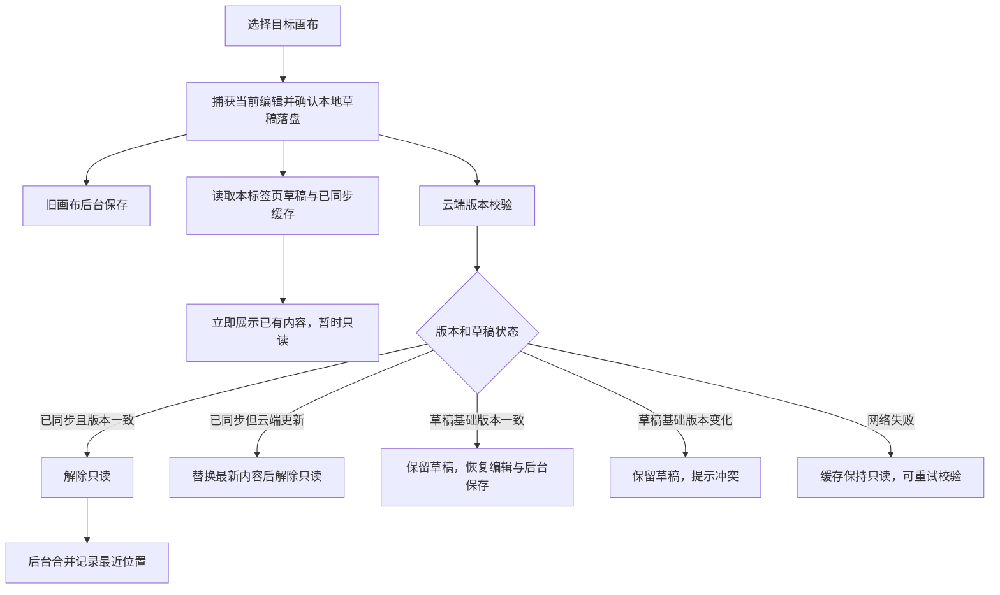

# 画布

[返回开发者指南](readme.md)

单人打开画布时继续使用快照保存；第二个编辑会话打开，或使用分享功能时才迁入协作协议。并发编辑、三种查看模式、离线队列及权限流程见[协作与分享](collaboration.md)。目录和排序流程不依赖保存协议。

画布的目录操作与内容保存分开处理：名称、顺序和归属在数据库中，图形、应用状态和图片组成场景快照。目录用例在 [useWorkspaceDirectory.ts](../../src/composables/useWorkspaceDirectory.ts)，内容读取在 [useCanvasDocument.ts](../../src/composables/useCanvasDocument.ts)，账号级缓存和后台资源在 [canvasResources.ts](../../src/lib/canvasResources.ts)，编辑器接入在 [ExcalidrawCanvas.client.vue](../../src/components/ExcalidrawCanvas.client.vue)。

## 创建画布

`createCanvas()` 等待当前编辑器保存，再通过 [POST /api/workspaces/:id/canvases](../../server/api/workspaces/[id]/canvases.post.ts) 提交名称和目录版本 `catalogRevision`。后端验证空间归属，通过 [db/canvases.ts](../../server/db/canvases.ts) 原子插入画布到目录顶部，并递增目录版本。

成功后前端重新读取 [GET /api/workspaces/:id/canvases](../../server/api/workspaces/[id]/canvases.get.ts)，再读取新画布、后台记录最近位置，后两步见[切换画布](#切换画布)。新画布尚无快照，读取时返回空场景。

创建失败时也重新确认目录，然后报告原错误。目录无法确认时锁定目录修改，避免继续使用旧版本操作。

## 切换画布

用户选择另一张画布时，`selectCanvas()` 捕获当前场景并等待最新草稿写入 IndexedDB，然后立即启动目标加载。旧画布的云端保存由账号级资源继续执行，不随 React 编辑器卸载取消；不同资源最多同时进行两次保存，同一资源仍只有一个保存请求。

素材库不参与这条加载链路，见[素材库按需读取](library.md#读取素材库)。没有本地内容时等待云端返回；有本地内容时允许平移、缩放和查看，禁止绘制、粘贴、拖放、导入、撤销、删除和素材插入。临时只读与用户自己开启的查看模式分别管理，初始化和只读视角变化不会触发保存。

[GET /api/canvases/:id](../../server/api/canvases/[id].get.ts) 先鉴权、检查 owner 和数据库归属。内存命中时携带 `If-None-Match`；服务器比较内容版本及目录元数据，完全相同返回无响应体的 `304`，不读取对象存储；版本变化返回完整内容。首次磁盘读取与网络请求并行，所以磁盘命中的第一次打开仍可能接收完整响应。所有响应保留 `Cache-Control: no-store`，缓存由应用主动管理。对象刚被并发保存替换时，重新读取数据库引用后再尝试一次。

切换和初始化目录期间，目录的新增、删除、重命名和排序暂不可用；画布与工作空间仍可继续切换，最后一次选择生效。删除成功会使对应的内存资源和已同步缓存失效，迟到的读取不能重新显示它。

快速切回仍在保存的画布，展示最新本地内容并保持只读，等自己的保存完成后再校验，避免把自己的新版本误判为外部修改。保存响应丢失时先回读版本和上传快照，确认已被接受后才确认保存；无法确定时保留草稿和冲突提示，不把草稿自动套用到新版本上。

快速点击多个画布时，最后一次选择决定当前编辑器；同一画布的读取合并，较晚返回的旧选择只更新对应缓存。[最近位置](../../src/composables/useWorkspaceNavigation.ts) 在后台按顺序写入，并合并等待中的选择；导航冲突只提示和读取最新版本，不移动当前画布。

### 缓存与草稿边界

[confirmedCache.ts](../../src/lib/confirmedCache.ts) 管理已同步快照；[persistence.ts](../../src/lib/persistence.ts) 管理未同步草稿。两者使用不同 IndexedDB 数据库，草稿不参与缓存淘汰。

| 内容             | 键与保留规则                                                                                                                 |
| ---------------- | ---------------------------------------------------------------------------------------------------------------------------- |
| 活跃或未同步资源 | 当前账号与画布，草稿另带独占标签页 ID；当前、dirty、保存中和校验中的资源固定保留                                             |
| 已同步内存资源   | 当前画布加最近四张未固定画布；估算序列化容量上限 64 MiB，当前画布及未同步资源不计入可淘汰项                                  |
| 已同步磁盘快照   | `schemaVersion + accountId + type + resourceId`，包含 revision、内容、字节数和最近访问时间；画布图片和素材库合计最多 256 MiB |

容量限制按序列化体积估算，并非浏览器实际堆内存上限。超大单项不强制放进可淘汰缓存；缓存不可用时回退云端，草稿写入失败且云端尚未保存成功时保留当前画布，不能无保护切走。

缓存只接收成功 GET 或 PUT 确认的不可变快照。保存期间产生的新编辑继续保持 dirty，旧响应不能确认新编辑，也不能用较旧 revision 回退缓存。账号切换清空内存、取消旧读取；权限失效或画布被删除后移除已同步缓存并停止显示该画布，未同步草稿仍独立保留。

## 打开多个画布

点击侧边栏文件会打开或激活一个标签，标签名随文件重命名更新。同一文件不会重复打开；标签只切换当前可见画布，页面始终挂载一个编辑器。顶栏不再显示工作空间面包屑，工作空间仍在侧边栏切换。

[useCanvasTabs.ts](../../src/composables/useCanvasTabs.ts) 按工作空间在内存保存标签顺序和当前标签。切换工作空间再返回会恢复原标签；退出账号或刷新页面后重新按最近位置打开画布，不跨账号复用标签。左右方向键、Home、End 可在标签间切换；Delete 或关闭按钮关闭标签。这些按键不会继续触发画布的移动、删除快捷键。

关闭当前标签先确认本地草稿落盘，再激活右侧相邻标签，没有右侧则激活左侧。关闭最后一个标签保留文件列表，显示打开侧边栏和新建画布入口；再次切换回这个工作空间也不会自动重开文件。关闭标签不会删除文件、释放未同步资源或取消后台保存。退出登录与站内离开继续等待全部画布保存；页面关闭提醒同时检查快照资源和已关闭标签的协作操作队列。只有当前显示的画布登记打开会话，后台标签不登记。

每个画布的视角和工具保存在 `CanvasResource.editorContext`，不写入共享内容。返回标签时，若画布内容签名和协作 epoch 未变，则恢复该画布的内容撤销/重做记录；保存确认只改变 revision 时仍可恢复。后台期间远端内容或 epoch 变化则清空旧历史，避免旧撤销覆盖他人修改。内容签名使用元素 ID、版本、nonce、删除状态、顺序和共享背景，忽略快照恢复时补齐的默认字段。

[editorHistory.ts](../../src/lib/editorHistory.ts) 在内存保留历史 delta 对象及撤销所需图片文件；编辑器 [History](../../packages/excalidraw/history.ts) 保留缺失元素的回退数据，恢复时不注入场景、不替换 Store 基线。协作标签重新打开时先等待本次 `view` 读取确认，避免复用会话中的旧视图误恢复历史。恢复发生在当前场景提交后，并通知撤销/重做按钮更新。关闭标签、刷新和退出账号清除历史；内容未变时恢复仍存在元素和分组的选区，不恢复活动文字编辑、线编辑对象或正在进行的拖拽。已同步场景仍按原 LRU 淘汰，轻量编辑上下文另留内存，不常驻多个编辑器。

## 保存内容

编辑器的 `onChange` 将场景交给 [PersistentResource](../../src/lib/persistence.ts)，暂存本地草稿并安排自动保存；`Ctrl+S` / `Cmd+S` 调用包装组件的 `saveManually()`，立即保存画布并等待素材库保存。显式保存没有新修改时不提交快照，仍显示保存反馈。

[PUT /api/canvases/:id](../../server/api/canvases/[id].put.ts) 接收 `{ revision, scene }`，其中 `scene` 包含 `elements`、`appState`、`files`。处理器校验归属和场景形状，再调用 [saveSnapshot()](../../server/utils/snapshots.ts)：校验版本 → 写入新快照 → 按预期版本更新数据库引用 → 后台删除旧快照。成功返回新的版本与更新时间。原子性边界见[版本与快照](architecture.md#版本与快照)。

单次 JSON 请求上限为 20 MB。保存失败时显示错误并尽可能保留本地草稿；切换画布或空间只等待本地保护，退出登录和站内离开等待该账号所有画布与已加载素材库的保存。刷新或关闭页面使用 `beforeunload` 提醒，关闭页面不会保证完成保存。

## 处理保存冲突

其他页面已保存同一画布，导致版本不符时，保存接口返回 `409 REVISION_CONFLICT`。[PersistentResource](../../src/lib/persistence.ts) 停止继续覆盖，包装组件提供下载本地备份，以及确认舍弃冲突草稿后加载云端内容的操作。

画布在请求前已被删除时，归属查询返回 `404 NOT_FOUND`，页面按保存失败保留草稿；若删除发生在归属查询之后、版本写入之前，则写入失败返回 `409 REVISION_CONFLICT`。

“加载云端”先清理发生冲突的资源草稿，再刷新页面；未冲突资源的待保存草稿保留。此操作沿页面初始化流程重新读取内容。画布冲突没有“自动合并后覆盖”的步骤，账户设置的冲突选择见[处理设置冲突](user-settings.md#处理设置冲突)。

## 重命名画布

`renameCanvas()` 等待保存，通过 [PATCH /api/canvases/:id](../../server/api/canvases/[id].patch.ts) 提交名称。后端更新元数据并返回画布信息；前端同时更新目录条目和当前文档名称。此操作不提交场景快照。

## 删除画布

`deleteCanvas()` 确认后等待保存，通过 [DELETE /api/canvases/:id](../../server/api/canvases/[id].delete.ts) 携带 `{ catalogRevision }`。后端校验归属和目录版本，删除画布、递增目录版本，并后台删除快照。

前端无论请求是否报错都会重新读取目录，确认画布是否仍存在；这也处理“服务端已删除但响应丢失”的情况。删除后移除对应标签与资源；若删除的是当前画布，刷新导航，再打开相邻的已打开标签，没有标签则保留空状态。其他文件仍可从侧边栏打开。

## 调整画布顺序

拖拽及键盘动作由 [useCanvasReorder.ts](../../src/composables/useCanvasReorder.ts) 转成完整 ID 顺序，交给 `useWorkspaceDirectory.reorderCanvas()`。前端先预览顺序，再通过 [PUT /api/workspaces/:id/canvas-order](../../server/api/workspaces/[id]/canvas-order.put.ts) 提交 `{ canvasIds, catalogRevision }`。

后端要求列表包含空间内全部画布、没有重复或遗漏，通过 [reorderCanvases()](../../server/db/canvases.ts) 原子更新顺序和目录版本。版本不符返回 `409 CATALOG_CONFLICT`。

请求失败后，前端先恢复原列表，再通过 [GET /api/workspaces/:id/canvases](../../server/api/workspaces/[id]/canvases.get.ts) 确认服务端结果，不自动重试旧顺序。目录仍无法读取时锁定目录修改，用户重新加载成功后再开放操作。

## 验证入口

[canvas-tabs.test.ts](../../tests/unit/canvas-tabs.test.ts) 检查标签去重、关闭草稿保护、工作空间恢复与账号重置；[canvas-tabs.spec.ts](../../tests/browser/canvas-tabs.spec.ts) 检查真实编辑器的工具/视角、内容撤销/重做、图片撤销、远端变化、后台保存、文件管理和窄屏布局。

[navigation.test.ts](../../tests/integration/navigation.test.ts) 覆盖目录版本、排序和导航；[node-storage.test.ts](../../tests/integration/node-storage.test.ts) 检查含图片快照读写、并发与重启持久化；[snapshots.test.ts](../../tests/unit/snapshots.test.ts) 检查发布失败的新对象回收；[persistence-owner.test.ts](../../tests/unit/persistence-owner.test.ts) 检查保存资源的账户归属与请求取消；[frontend-controllers.test.ts](../../tests/unit/frontend-controllers.test.ts) 检查读取和切换保护。[canvas-cache.test.ts](../../tests/unit/canvas-cache.test.ts) 检查缓存、异步保存、乱序、草稿和账号边界；[conditional-snapshots.test.ts](../../tests/integration/conditional-snapshots.test.ts) 检查鉴权后条件读取和对象读取次数；[canvas-cache.spec.ts](../../tests/browser/canvas-cache.spec.ts) 在真实 Chromium 检查只读输入隔离、后台保存、素材库懒加载和受控时序。运行方式见[开发验证](testing.md)。
