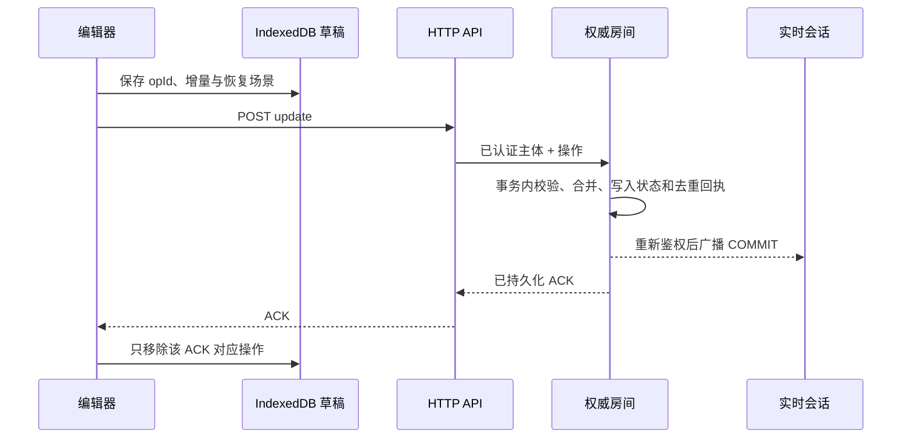

# 协作与分享

[返回目录](../../README.md#目录) · [Issue #12](https://github.com/qiudeng7/excalidraw-workspace/issues/12)

## 从使用流程进入代码

### 成员邀请与链接

所有者在画布顶部打开 [CanvasSharePanel.vue](../../src/components/CanvasSharePanel.vue)，按邮箱邀请已有账号或生成可撤销的链接。账号邀请出现在“与我共享”，打开 `/c/:id`；分享链接使用 `/share/:id#secret`，前端把 fragment secret 交换为短期、不透明的访问 capability 后移除 fragment，按账号保存在当前标签页的 sessionStorage。请求携带 `X-Canvas-Access`，链接上下文始终按该链接授权，即使打开者本身是所有者也不能升级权限。

画布默认私有。所有者管理权限，编辑者可以绘图，查看者保持只读。分享链接默认要求登录、有效期 7 天，也可允许匿名访问、调整有效期或撤销；删除固定版本后，对应访问失效。分享不包含所有者的个人素材库、设置或其他画布。协作同步和连接状态统一显示在顶部的保存状态处。

### 三种查看模式

| 身份 / 查看方式 | 内容加载与后续行为                         | 实时连接           |
| --------------- | ------------------------------------------ | ------------------ |
| 所有者、编辑者  | 单人先用快照保存；并发或显式分享后增量同步 | 按需               |
| 实时查看        | 初始快照 + 后续提交，始终只读              | 第二会话出现后按需 |
| 最新版查看      | 打开或手动刷新读取最新持久化内容           | 无                 |
| 固定版本查看    | 指定发布版本的标题、内容与图片；重开不变   | 无                 |

最新版和固定版定期只检查访问权限，不刷新内容；网络恢复和页面重新可见也不刷新其场景。固定版失效返回 410，不能回退为最新版。访客不加载账号设置、目录或素材库；已登录访问者使用自己的编辑器设置。

HTTP 路由位于 [server/api/canvases/[id]/collaboration/](../../server/api/canvases/[id]/collaboration/)，以 [service.ts](../../server/collaboration/service.ts) 组合会话、迁移、房间命令与图片读取。房间权威授权由 [room.ts](../../shared/collaboration/room.ts) 完成；全局管理员不是画布所有者。目录投影仅提供发现入口，每次读取仍经过房间授权。

## 持久化与通信

更新通过 HTTP 提交，保证大量元素导入是一个原子操作；WebSocket 只传提交广播、重同步信号与在线状态。超过 60,000 字符的广播发送 `RESYNC`，客户端回读权威场景，避免大 WebSocket 帧。浏览器用 PartySocket 管理连接超时与退避重连，每次连接重新鉴权并申请 ticket，不缓存离线 WebSocket 消息；持久化操作仍使用独立的 ACK 队列。加入连接先消费一分钟有效的一次性 ticket；READY 后再次读取场景，覆盖“读快照到加入连接”之间的窗口。

客户端为 `access`、`ticket`、`presence` 请求和 WebSocket Upgrade 各设置 10 秒超时，OPEN 后另用 10 秒等待 AUTH 的 `READY`；场景 `view` 读取允许 120 秒，READY 后也须成功读回权威场景才标记实时连接成功。编辑提交 `update` 和图片上传 `assets` 不套用这些短超时。连接或读取超时不清除本地草稿；READY 等待超时会关闭本次连接，通过既有退避和参与会话轮询重新申请票据，HTTP 仍有权限时可继续编辑、保存。实际权限或 epoch 变更仍执行原有锁定与恢复流程。`CollaborationSession.connectionDiagnostic` 和浏览器控制台的“协作连接阶段失败”区分 `access`、`ticket`、Upgrade、等待 READY 和 READY 后读取场景等阶段；诊断只记录阶段、状态、原因和时间，不包含 ticket、capability、Cookie、请求 URL 或场景内容。阶段记录用于定位等待位置，具体原因需结合 HTTP 状态、WebSocket 帧与服务端日志判断。

Cloudflare 由 [CanvasRoom](../../server/collaboration/durable-object.ts) 使用 SQLite 同步事务保存状态与去重回执，通过 PartyServer 管理 hibernation WebSocket。Node 由 [node.ts](../../server/collaboration/node.ts) 在 SQLite 中 CAS 更新房间状态，提交后在同进程广播；仅支持单进程部署。网络响应或广播失败不回滚已经提交的状态，客户端用相同 opId 重试。

房间状态以 JSON 保存，DO 按 32,000 字符分行以避开单个 SQLite 值的限制。每次事务读取、写入当前房间，是本版的实现边界；大量持续编辑的成本与目标负载的延迟需要单独测量。成员目录用带权限版本的 outbox 投影到 D1 / SQLite，失败按分钟重试；较旧投影不能覆盖新权限。

## 合并、撤销与离线恢复

### 并发编辑

元素复用 Excalidraw 的 id、version、versionNonce、index、isDeleted。合并与索引修复从编辑器源码抽出无 DOM 依赖的 `@excalidraw/excalidraw/reconcile` 入口，编辑器和房间共用同一套上游算法。较高 version 胜出，同版本较小 nonce 胜出；相同版本和 nonce 却内容不同会拒绝。不同元素可并发合并；删除是带版本的 tombstone，同元素更新也可能胜出。房间统一修复不合法或重复的 fractional index，并广播修复结果。文本按整个元素合并，不提供字符级 CRDT。当前沿用编辑器原生元素语义；若引入 Yjs，需要先设计元素和文本的绑定模型以及撤销语义，不能把整张场景 JSON 放入 Y.Doc 就视为完成协作。

本地导入或重置导致元素从数组消失时，包装组件用 Excalidraw 的 `newElementWith` 生成删除增量；仅对编辑器此前显示过的元素处理，不能误删交互期间尚未显示的远端新增元素。

只有元素和画布背景共享；工具、选中、缩放和平移不写入共享内容。背景更新携带原值前提。远端内容使用 `CaptureUpdateAction.NEVER` 注入；撤销 / 重做依赖 Excalidraw 本地历史，并额外携带元素版本前提，在服务端事务内检查，跳过已被对方修改的元素。

### 离线队列

[session.ts](../../src/lib/collaboration/session.ts) 保存“已确认基线 + 待提交增量”，连续拖拽合并尚未发出的尾部操作。已经尝试提交的操作直到 ACK 前保持内容不变，ACK 丢失后的新修改使用新 opId；重载恢复的操作也按已尝试提交处理。草稿存储用 `idb` 管理 IndexedDB 连接与事务完成确认，写入最多一份进行中与一份最新待写草稿，草稿同时保留完整恢复场景；切换画布等待本地 checkpoint，后台继续上传。ACK 只确认对应 opId，不能清掉发送期间产生的新编辑。近期未活跃的干净房间保留四张，活动会话和未同步队列固定保留。

去重窗口最多 2,000 个提交或 16 MiB 回执；回执保留序号和跳过结果，不重复保存完整元素。重复请求返回 `replayed` 回执，客户端回读当前权威内容。超出窗口或 epoch 不符的草稿进入恢复状态，保留下载，不能整图覆盖云端。授权失效也停止自动提交。首次访问需要在线鉴权；已经确认过权限的编辑会话可继续离线编辑。

缓存键包含协议、账号 / 访客主体、画布、授权来源、角色、查看方式、固定版本和 epoch；缓存读取前先确认当前权限。草稿键保留标签页隔离且不随 epoch 改变，以便恢复后仍能发现旧队列并提供下载。克隆标签页通过已有 navigator.locks 身份机制重新分配 clientId，避免 opId / clientSeq 身份混用。

### 权限撤销

角色或授权来源改变后，同一身份、画布和标签页下的旧授权草稿仍能被发现，但不会以新权限自动提交。恢复提示提供下载备份和“放弃草稿并重新读取”；取消确认保留原队列，明确确认后仅删除所选草稿，重新鉴权读取云端内容并清空旧撤销历史。只有查看权限时仍为只读，恢复编辑权限后可继续新编辑；其他账号、画布和标签页的草稿不受影响。

## 迁移、删除、图片与备份

所有者在工作空间单人打开画布时继续使用 `legacy` 快照与版本 CAS，读取接口不会创建房间。只有第二个同时打开的标签页 / 浏览器出现，或用户明确打开分享、邀请、发布版本、访问协作入口 `/c/:id`，才按需进入 `legacy → preparing → collaborative`。已创建的房间保留，不随人数减少而降级。

[useCanvasPresence.ts](../../src/composables/useCanvasPresence.ts) 为工作空间中仍使用快照协议的当前画布调用 `POST /api/canvases/:id/presence`；进入增量协议后，[session.ts](../../src/lib/collaboration/session.ts) 改用 `POST /api/canvases/:id/collaboration/presence`。两条入口对同一账号和标签页使用一致的参与身份。后端逐次鉴权，再用 [open-sessions.ts](../../server/collaboration/open-sessions.ts) 在 D1 / SQLite 的 `canvas_sessions` 登记会话；已有房间只登记租约，绝不降回快照协议或重新播种场景。最新版与固定版本查看不登记实时参与方。

权限按账号或分享凭证决定，参与方按独立浏览器标签页计算：同账号的不同设备、浏览器、标签页各算一个会话。克隆标签页通过 `navigator.locks` 排除身份重复；刷新复用原标签页标识。页面显示“个会话在线”，提示中可按账号汇总，人数不会把同账号的两个设备合并成一人。服务端用可信授权主体和标签页标识派生租约键，客户端不能用猜中的其他标签页标识删除另一账号的会话；同账号同标签页切换授权上下文不会因此重复计数。

尚未创建房间的画布单人每 30 秒续租，第二个有效会话出现时才升级。已有房间在 HTTP 鉴权和最新场景读取成功后即可编辑并通过原有增量 ACK 队列保存，单人不用等待 WebSocket；持久化协议与实时连接分别决定。已有房间的实时会话每 15 秒续租，第二个会话到来后才尝试实时连接，首位最迟在下次续租时发现对方；最后一位对方离开后断开不必要的连接，继续 HTTP 保存。WebSocket 失败不把 HTTP 已成功保存的内容标为未同步草稿；实时连接中断单独显示，无可用实时连接时每次轮询也读取最新场景，使可用的 HTTP 通道仍能收敛。真正的 HTTP 保存失败仍保留原有离线队列与恢复流程。WebSocket 的 `ERROR` 或权限变更通知先触发 HTTP 重新鉴权，只有权威权限失效才锁定编辑；传输凭证过期不能把仍有权限的编辑器永久变为只读。

租约 150 秒未续期视为离开。切换画布、卸载编辑器、pagehide 尝试发送 keepalive 离开通知，即使该画布还有后台上传队列也不再续租。续租返回服务端单调递增的租约到期值，离开必须携带对应值；同一文档内各编辑器作用域还共用按画布串行的租约请求队列，防止旧续租越过新作用域的续租；刷新、快速重开或跨组件接力时迟到的旧离开不会删除新租约。网络中断或撤权后离开失败时依靠到期清理，因此在线数存在最长约 150 秒的保守窗口。后台定时器受浏览器限制；重新可见或网络恢复时检查权限并读取权威场景，bfcache 返回保留当前内存中的待提交队列，不以旧 checkpoint 替换在途编辑。

租约键使用新的 `presence:` 命名空间；升级前遗留的未隔离租约不会重复计入，并按原 TTL 清理。旧版本页面没有新的续租机制，不能保证即时识别这类页面的存在；发布后应刷新所有打开的页面。HTTP 轮询和既有元素合并协议继续避免把整个旧场景覆盖云端，不为兼容旧页面降级房间、重置 epoch 或清空权限。

升级复用原有冻结流程：先以数据库 CAS 冻结旧 PUT 的最终发布，再从已冻结快照构造房间；重试只创建缺失房间，不覆盖已存在房间。已上传 Blob 但尚未发布的旧保存会被 CAS 拒绝，不能覆盖房间初始场景或删除其引用的旧快照。旧 PUT 返回 `COLLAB_PROTOCOL_REQUIRED` 时客户端立即重新读取；CAS 围栏拒绝在途保存时同样返回这一协议升级码，普通版本竞争仍返回 `REVISION_CONFLICT`。

升级前由旧包装组件提交活跃文字编辑并 checkpoint；输入法仍在组合时先等待 compositionend，保留旧编辑器，不能先设只读或卸载再取内容。单人草稿同时保存已确认基线。画布冻结时额外记录初始 `migrationEpoch`，自动交接仅接受仍处于此 epoch 的房间；已执行备份恢复的房间和无法确认初始 epoch 的旧房间保留草稿恢复，不向新 epoch 自动重放。切换到协作时，只提取相对基线变化的元素、删除和背景，不把未变更的旧元素覆盖到新场景。增量沿用现有版本合并与背景前提，保留远端新增内容；先将待提交操作 checkpoint 到协作草稿数据库，成功后才删除原快照草稿。迁移窗口崩溃可能重复提取相同版本的增量，合并保持幂等。旧浏览器留下的草稿若没有基线，仍保留原冲突恢复和下载入口，避免推测用户修改。

删除先提交房间 tombstone，再删除目录；重试把已存在 tombstone 视为成功。删除工作空间先写入 deleting intent，阻止创建新子画布，再逐房间关闭访问。恢复后的房间使用新 epoch，旧连接和待提交操作失效。

图片存入画布命名空间的内容寻址对象，先上传、再在房间登记 fileId，最后提交引用它的元素。相同 fileId 不允许指向另一份内容。单图 dataURL 上限 10 MiB，画布最多登记 2,000 个图片，场景与单次普通请求上限 20 MiB；固定版本最多 30 个、成员 500 个、链接 100 个、实时连接 50 个。

固定版本拥有独立不可变场景对象及图片清单。旧快照清理器跳过 `collaboration/`；协作清理器依据房间状态，每日清理超过 24 小时且未引用的对象。当前保守保留全部已登记图片以支持撤销，删除画布后才释放全部引用。房间备份、对象校验和新 epoch 恢复见[部署说明](../deployment.md#备份和恢复)。

## 验证

[collaboration.test.ts](../../tests/unit/collaboration.test.ts) 覆盖确定性合并、同元素与删除竞争、幂等、权限、固定版本、撤销前提和过期基线；[collaboration-client.test.ts](../../tests/unit/collaboration-client.test.ts) 覆盖重连时重新申请票据、迟到 ACK、重载重试和旧 epoch 草稿下载。集成套件使用真实 H3、SQLite 与文件对象存储，验证迁移冻结、目录投影恢复、删除重试和房间备份恢复。[lazy-collaboration.test.ts](../../tests/integration/lazy-collaboration.test.ts) 额外验证单人不建房、同时进入、刷新身份、离开和超时、旧 PUT 上传后的 CAS 围栏、既有房间及所有权。真实协作浏览器套件覆盖第二个浏览器加入时首位在途保存的交接及重新加载。

`CHROMIUM_PATH=/usr/bin/chromium pnpm test:collaboration node` 和 `… pnpm test:collaboration worker` 分别构建并启动隔离的真实服务，运行备份 CLI 回归及无 API mocks 的协作浏览器用例，最后关闭服务并删除测试数据。两种目标须串行执行；这些本地验证不代替线上 DO 故障恢复演练或目标负载压测。
